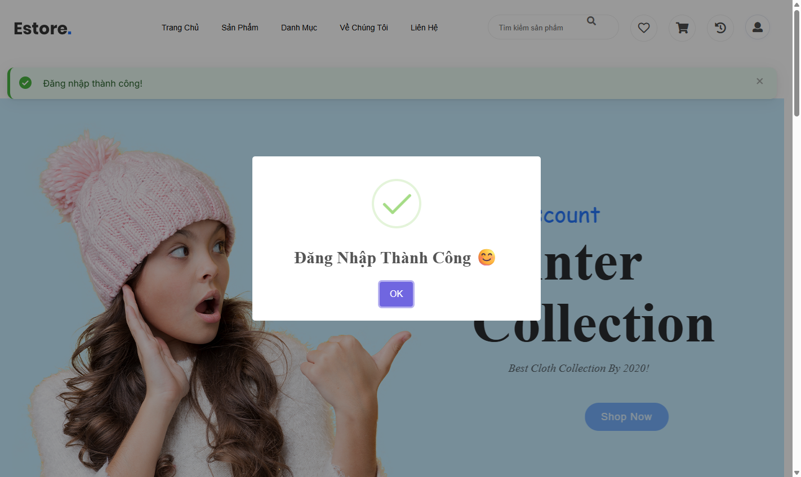
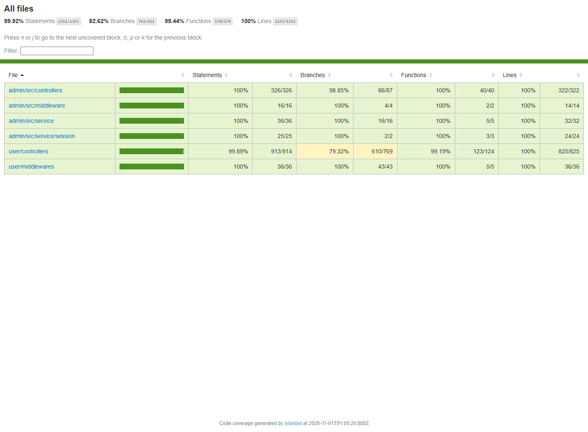
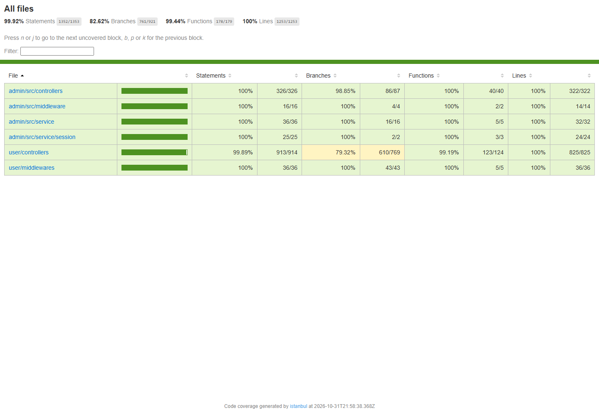
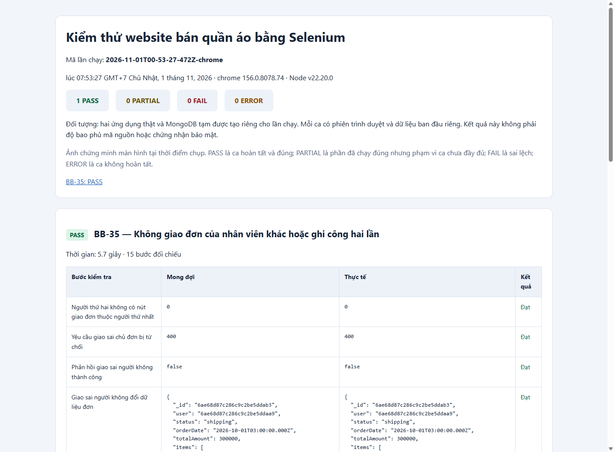
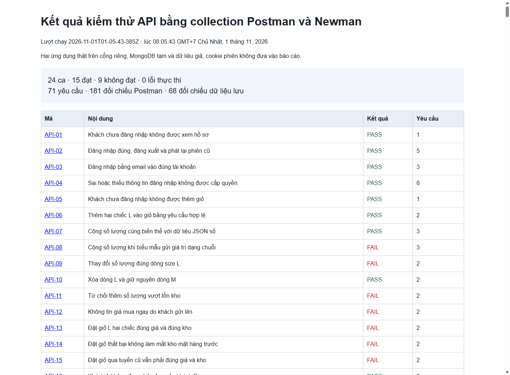
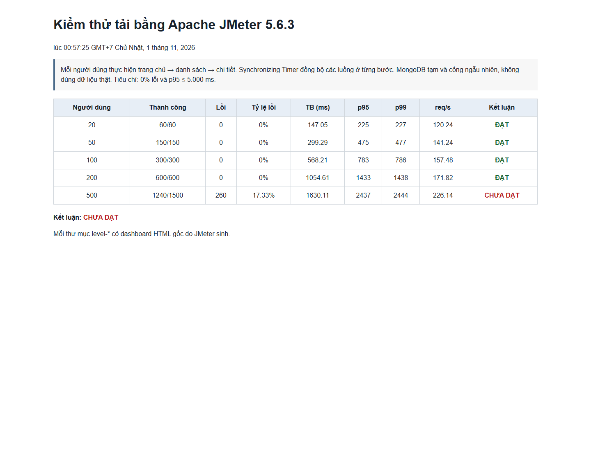
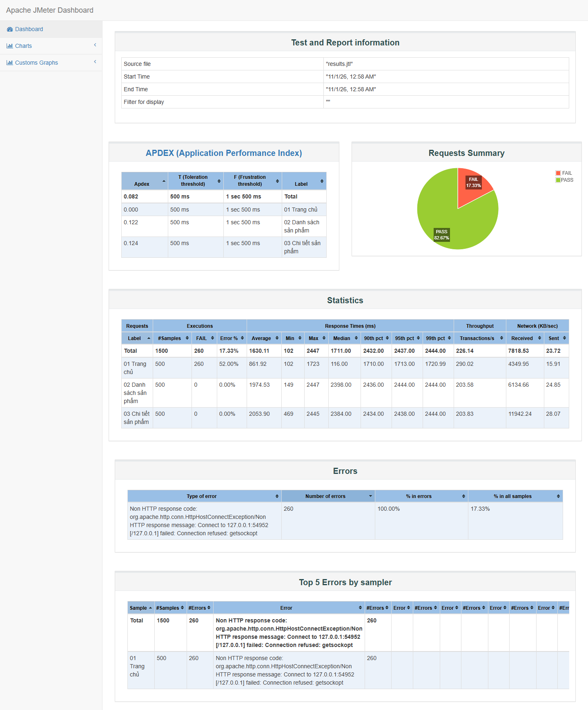

# KẾ HOẠCH KIỂM THỬ PHẦN MỀM

## Website bán quần áo trực tuyến

| Thuộc tính | Nội dung |
|---|---|
| Tên tài liệu | Kế hoạch kiểm thử phần mềm Website bán quần áo trực tuyến |
| Mã tài liệu | KHKT-WEBQA-01 |
| Phiên bản | 2.0 |
| Ngày ban hành | 30/10/2026 |
| Thời gian thực hiện | 30/10/2026 – 01/11/2026 |
| Đơn vị thực hiện | Nhóm thực hiện đề tài |
| Trạng thái | Bản chính thức |

## 1. Mục đích tài liệu

Tài liệu này xác định phạm vi, mục tiêu, phương pháp, nguồn lực, môi trường, tiến độ và tiêu chí hoàn thành của hoạt động kiểm thử đối với Website bán quần áo trực tuyến. Kế hoạch là căn cứ để thiết kế ca kiểm thử, tổ chức thực thi, thu thập minh chứng, quản lý khiếm khuyết và đánh giá chất lượng phần mềm một cách nhất quán.

Kế hoạch tập trung vào các luồng nghiệp vụ có rủi ro cao của hệ thống thương mại điện tử, gồm xác thực người dùng, tra cứu sản phẩm, quản lý giỏ hàng, đặt hàng, quản lý tồn kho theo biến thể, quản trị sản phẩm, điều phối giao hàng, tính thù lao nhân viên giao hàng, kiểm soát truy cập và khả năng chịu tải.

## 2. Cơ sở xây dựng kế hoạch

Kế hoạch được xây dựng dựa trên các nguồn sau:

1. Mã nguồn và tài liệu hướng dẫn của dự án Website bán quần áo trực tuyến.
2. Yêu cầu nghiệp vụ được xác định từ giao diện, tuyến xử lý và mô hình dữ liệu của hệ thống.
3. ISO/IEC/IEEE 29119 về quy trình và tài liệu kiểm thử phần mềm.
4. ISO/IEC 25010 về mô hình chất lượng sản phẩm phần mềm.
5. OWASP Web Security Testing Guide đối với các nội dung kiểm soát truy cập, phiên đăng nhập, dữ liệu đầu vào và yêu cầu thay đổi trạng thái.
6. Tài liệu chính thức của Jest, Selenium WebDriver, Postman/Newman và Apache JMeter.

## 3. Tổng quan hệ thống được kiểm thử

Hệ thống là ứng dụng web thương mại điện tử được xây dựng bằng Node.js, Express và EJS, sử dụng MongoDB để lưu dữ liệu. Dự án gồm hai ứng dụng chính:

- Ứng dụng khách hàng và nhân viên giao hàng, phục vụ tại cổng 3000 trong cấu hình chạy thông thường.
- Ứng dụng quản trị, phục vụ tại cổng 3001 trong cấu hình chạy thông thường.

Ba nhóm tác nhân trực tiếp tương tác với hệ thống gồm:

- Khách hàng: đăng ký, đăng nhập, tìm kiếm sản phẩm, chọn biến thể, quản lý giỏ hàng, đặt hàng, hủy đơn và theo dõi lịch sử mua hàng.
- Quản trị viên: quản lý người dùng, danh mục, sản phẩm, giá, tồn kho và trạng thái đơn hàng.
- Nhân viên giao hàng: nhận đơn, cập nhật tiến trình giao, hủy giao, xác nhận giao thành công và theo dõi thù lao.

## 4. Mục tiêu kiểm thử

Hoạt động kiểm thử nhằm đạt các mục tiêu sau:

1. Xác minh các chức năng chính đáp ứng yêu cầu nghiệp vụ và tiêu chí nghiệm thu.
2. Phát hiện sai lệch trong xử lý biến thể sản phẩm, số lượng, đơn giá, tổng tiền, tồn kho và trạng thái đơn hàng.
3. Xác minh cơ chế xác thực, phân quyền và bảo vệ dữ liệu theo vai trò người dùng.
4. Đánh giá các nhánh xử lý quan trọng trong mã nguồn bằng kiểm thử hộp trắng và số liệu độ phủ.
5. Tự động hóa các luồng giao diện và API có tính lặp lại cao.
6. Đánh giá hành vi của hệ thống trong các tình huống đồng thời, thao tác lặp, dữ liệu bất thường và yêu cầu khác nguồn.
7. Xác định ngưỡng tải quan sát được trong môi trường thử nghiệm cục bộ.
8. Thiết lập khả năng truy vết hai chiều giữa yêu cầu, ca kiểm thử, kết quả, minh chứng và khiếm khuyết.

## 5. Đối tượng kiểm thử

Các thành phần thuộc đối tượng kiểm thử gồm:

- Controller, middleware và service của ứng dụng khách hàng, giao hàng và quản trị.
- Giao diện đăng ký, đăng nhập, hồ sơ, danh sách sản phẩm, chi tiết sản phẩm, giỏ hàng, thanh toán và lịch sử đơn hàng.
- Giao diện quản trị người dùng, danh mục, sản phẩm, tồn kho và đơn hàng.
- Giao diện nhân viên giao hàng và các thao tác nhận, giao hoặc hủy đơn.
- Các tuyến HTTP phục vụ xác thực, giỏ hàng, đặt hàng, quản trị và giao hàng.
- Dữ liệu MongoDB liên quan đến người dùng, sản phẩm, danh mục, giỏ hàng và đơn hàng.
- Khả năng đáp ứng của các trang công khai dưới các mức tải đồng thời đã xác định.

## 6. Phạm vi kiểm thử

### 6.1. Nội dung thuộc phạm vi

Phạm vi kiểm thử bao gồm:

- Kiểm thử chức năng theo phương pháp hộp đen.
- Kiểm thử cấu trúc và nhánh xử lý theo phương pháp hộp trắng.
- Kiểm thử giao diện tự động bằng Selenium WebDriver trên Chrome và Firefox.
- Kiểm thử API bằng Postman và Newman, có đối chiếu dữ liệu lưu trong MongoDB.
- Kiểm thử hồi quy đối với các luồng nghiệp vụ trọng yếu.
- Kiểm thử đồng thời, tính lặp an toàn, dữ liệu bất thường, phân quyền, yêu cầu khác nguồn và tương thích vùng hiển thị.
- Kiểm thử hiệu năng tải bằng Apache JMeter tại các mức 20, 50, 100, 200 và 500 người dùng đồng thời.
- Đo độ phủ mã nguồn bằng Jest và Istanbul.

### 6.2. Nội dung ngoài phạm vi

Các nội dung sau không thuộc phạm vi kết luận của đợt kiểm thử:

- Kiểm thử trên hạ tầng production hoặc mạng Internet công cộng.
- Kiểm thử ứng dụng di động gốc vì dự án chỉ cung cấp ứng dụng web.
- Đánh giá chuyên sâu mã nguồn của thư viện bên thứ ba.
- Kiểm thử xâm nhập toàn diện bởi đơn vị an ninh độc lập.
- Kiểm thử khả năng khôi phục thảm họa, sao lưu dài hạn và cụm cơ sở dữ liệu phân tán.
- Chứng nhận khả năng chịu tải cho cấu hình máy chủ khác với máy thử nghiệm.

Giới hạn phạm vi không làm mất giá trị của các kết quả đã quan sát, nhưng phải được nêu rõ khi diễn giải và không được suy rộng kết luận ra ngoài môi trường thử nghiệm.

## 7. Yêu cầu và tiêu chí nghiệm thu

| Mã yêu cầu | Nội dung | Tiêu chí nghiệm thu chính |
|---|---|---|
| REQ-01 | Xác thực người dùng | Kiểm tra ràng buộc đăng ký; từ chối thông tin sai hoặc trùng; cấp đúng phiên và vai trò; đăng xuất làm mất quyền của phiên cũ. |
| REQ-02 | Quản lý giỏ hàng | Phân biệt đúng sản phẩm, màu và kích cỡ; cộng dồn đúng dòng; chặn số lượng không hợp lệ hoặc vượt tồn; tính đúng thành tiền. |
| REQ-03 | Đặt hàng và trừ tồn kho | Lưu đúng đơn giá tại thời điểm mua; trừ đúng tồn kho của biến thể; không tạo đơn hoặc làm thay đổi kho khi giao dịch thất bại. |
| REQ-04 | Điều phối và thù lao nhân viên giao hàng | Chuyển trạng thái theo đúng quy trình; chỉ người hợp lệ được thao tác; tiền công được tính đúng và chỉ ghi nhận một lần. |
| REQ-05 | Quản trị sản phẩm và kho | Chỉ quản trị viên được truy cập; dữ liệu bắt buộc đầy đủ; tệp ảnh được xử lý đúng; giá và tồn kho không nhận giá trị âm hoặc sai kiểu. |
| REQ-06 | Tra cứu và lọc sản phẩm | Tìm kiếm không phân biệt hoa thường; lọc đúng danh mục; hiển thị đúng biến thể, giá và tồn kho; xử lý rõ trường hợp không có kết quả. |
| REQ-07 | Kiểm soát quyền và dữ liệu | Chặn truy cập trái vai trò, truy cập đơn ngoài chủ sở hữu và thao tác trên đơn của nhân viên khác; không tin cậy giá hoặc quyền do máy khách gửi lên. |
| REQ-NF-01 | Tính toàn vẹn khi có tranh chấp | Nhiều yêu cầu đồng thời không được làm âm kho, tạo nhiều đơn cho một đơn vị hàng hoặc ghi nhận cùng một đơn cho nhiều người. |
| REQ-NF-02 | Khả năng chịu lỗi và ổn định API | Dữ liệu bất thường phải bị từ chối có kiểm soát; dịch vụ không bị dừng ngoài dự kiến; không lưu dữ liệu sai. |
| REQ-NF-03 | Tương thích trình duyệt và vùng hiển thị | Các luồng chính hoạt động nhất quán trên Chrome và Firefox; nội dung cốt lõi sử dụng được ở kích thước desktop, tablet và điện thoại. |

## 8. Chiến lược kiểm thử

### 8.1. Kiểm thử hộp đen

Kiểm thử hộp đen đánh giá hành vi quan sát được của hệ thống mà không phụ thuộc vào cấu trúc cài đặt. Các kỹ thuật được sử dụng gồm:

- Phân lớp tương đương cho dữ liệu hợp lệ và không hợp lệ.
- Phân tích giá trị biên cho độ dài tên đăng nhập, mật khẩu, số lượng, giá và tồn kho.
- Bảng quyết định cho đặt hàng, hủy đơn, duyệt đơn và giao hàng.
- Kiểm thử chuyển trạng thái cho vòng đời đơn hàng.
- Đoán lỗi đối với dữ liệu rỗng, sai kiểu, trùng lặp và truy cập trái quyền.

Mỗi ca phải nêu rõ mã ca, yêu cầu liên quan, điều kiện tiên quyết, dữ liệu thử, các bước thực hiện, kết quả mong đợi, kết quả thực tế, trạng thái và minh chứng.

### 8.2. Kiểm thử hộp trắng

Kiểm thử hộp trắng sử dụng Jest, Supertest, mock và cơ sở dữ liệu tạm để kiểm tra các nhánh xử lý của controller, middleware và service. Phương pháp gồm:

- Bao phủ câu lệnh, dòng lệnh, hàm và nhánh điều kiện.
- Phân tích đồ thị dòng điều khiển đối với các hàm nghiệp vụ quan trọng.
- Tính độ phức tạp chu trình theo công thức `V(G) = E - N + 2P` và số điểm quyết định cộng một.
- Thiết kế đường cơ sở cho các nhánh thành công, từ chối dữ liệu và xử lý ngoại lệ.

Mục tiêu độ phủ là tối thiểu 85% đối với dòng lệnh, câu lệnh, hàm và nhánh. Mọi chỉ số chưa đạt mục tiêu phải được giải thích trong báo cáo kết quả và được xem xét khi đánh giá rủi ro còn lại.

### 8.3. Kiểm thử giao diện tự động

Selenium WebDriver được dùng để tự động hóa các hành trình liên phân hệ từ khách hàng đến quản trị viên và nhân viên giao hàng. Các ca được chạy độc lập trên Chrome và Firefox, sử dụng phiên trình duyệt và dữ liệu thử riêng.

Một ca chỉ được xác định là đạt khi toàn bộ điểm kiểm tra về điều hướng, nội dung hiển thị, dữ liệu lưu và trạng thái nghiệp vụ đều phù hợp. Thông báo thành công trên giao diện không được xem là bằng chứng duy nhất nếu nghiệp vụ còn yêu cầu đối chiếu cơ sở dữ liệu.

### 8.4. Kiểm thử API

Postman và Newman được dùng để gửi yêu cầu HTTP, kiểm tra mã phản hồi, nội dung phản hồi, cookie phiên và thay đổi dữ liệu. Sau các thao tác có tác động, kết quả phải được đối chiếu với MongoDB tạm.

Phạm vi API bao gồm xác thực, hồ sơ, giỏ hàng, đặt hàng, quản trị và giao hàng. Mỗi ca API có thể chứa nhiều yêu cầu và nhiều assertion; trạng thái của ca được quyết định theo toàn bộ tiêu chí nghiệp vụ, không chỉ theo mã HTTP.

### 8.5. Kiểm thử nâng cao và bảo mật

Các tình huống nâng cao gồm:

- Hai khách hàng mua đồng thời sản phẩm cuối cùng.
- Hai nhân viên giao hàng nhận cùng một đơn.
- Gửi lặp yêu cầu xác nhận giao hàng.
- Fuzzing bằng trường rỗng, sai kiểu, số âm, số lẻ, chuỗi dài, ký tự đặc biệt và payload dạng truy vấn.
- Kiểm tra đúng vai trò, đúng chủ sở hữu và mất quyền sau đăng xuất.
- Kiểm tra yêu cầu thay đổi trạng thái từ nguồn không hợp lệ.
- So sánh hành vi trên Chrome và Firefox.
- Kiểm tra ba vùng hiển thị đại diện: 1366 × 768, 768 × 1024 và 375 × 812.

### 8.6. Kiểm thử tải

Apache JMeter 5.6.3 được dùng để mô phỏng 20, 50, 100, 200 và 500 người dùng đồng thời. Mỗi người dùng thực hiện ba bước: mở trang chủ, mở danh sách sản phẩm và mở chi tiết sản phẩm. Synchronizing Timer được sử dụng để tạo tải đồng thời tại từng bước.

Tiêu chí của từng mức tải:

- Tỷ lệ yêu cầu lỗi bằng 0%.
- Thời gian phản hồi p95 không vượt quá 5.000 ms.
- Không xuất hiện lỗi dừng ứng dụng hoặc mất tính nhất quán dữ liệu thử.

Kết quả chỉ phản ánh môi trường cục bộ, cấu hình máy và phiên bản phần mềm tại thời điểm đo.

### 8.7. Kiểm thử hồi quy

Sau mỗi thay đổi có ảnh hưởng đến nghiệp vụ, phải chạy lại ca phát hiện lỗi, các ca cùng yêu cầu và các luồng đầu cuối liên quan. Việc sửa lỗi chỉ được xác nhận khi ca ban đầu đạt và không làm phát sinh sai lệch ở các ca hồi quy.

## 9. Quy mô bộ kiểm thử

Bộ kiểm thử chính gồm 94 ca, được phân bổ như sau:

| Nhóm kiểm thử | Mã ca | Số ca |
|---|---|---:|
| Hộp đen | BB-01 đến BB-36 | 36 |
| Hộp trắng | WB-01 đến WB-18 | 18 |
| Giao diện Selenium | UI-01 đến UI-08 | 8 |
| API Postman/Newman | API-01 đến API-24 | 24 |
| Nâng cao và bảo mật | ADV-01 đến ADV-08 | 8 |
| **Tổng cộng** |  | **94** |

Ngoài 94 ca trên, kiểm thử hiệu năng gồm 5 kịch bản tải tương ứng 20, 50, 100, 200 và 500 người dùng đồng thời. Bộ Jest có 134 phép kiểm tra tự động phục vụ xác minh chi tiết và đo độ phủ; số phép kiểm tra Jest không được cộng lặp vào tổng số 94 ca cấp báo cáo.

## 10. Môi trường kiểm thử

| Thành phần | Cấu hình sử dụng |
|---|---|
| Hệ điều hành | Windows |
| Nền tảng thực thi | Node.js 22.20.0; npm 10.9.3 |
| Cơ sở dữ liệu | MongoDB tạm qua `mongodb-memory-server` 10.2.3 |
| Kiểm thử đơn vị và độ phủ | Jest 30.2.0; Supertest 7.1.4; Istanbul |
| Kiểm thử giao diện | Selenium WebDriver 4.35.0 |
| Trình duyệt | Google Chrome 156; Mozilla Firefox 159 |
| Kiểm thử API | Postman Desktop; Newman 6.2.3 |
| Kiểm thử tải | Apache JMeter 5.6.3; OpenJDK 21 LTS |

Bộ kiểm thử tự động tạo MongoDB tạm, dữ liệu giả và các cổng localhost còn trống. Dữ liệu kinh doanh đang sử dụng để chạy website thông thường không được dùng làm dữ liệu kiểm thử tự động.

## 11. Chuẩn bị và quản lý dữ liệu thử

Dữ liệu thử phải có định danh rõ ràng, có khả năng tái tạo và được cô lập giữa các ca. Tập dữ liệu chuẩn tối thiểu gồm:

- Hai tài khoản khách hàng độc lập.
- Một tài khoản quản trị viên.
- Hai tài khoản nhân viên giao hàng.
- Sản phẩm có ít nhất hai màu hoặc kích cỡ với đơn giá và tồn kho khác nhau.
- Một biến thể hết hàng, một biến thể còn đúng một đơn vị và một biến thể có tồn kho đủ lớn.
- Đơn hàng đại diện cho các trạng thái chờ duyệt, chờ giao, đang giao, đã giao và đã hủy.

Mỗi ca phải khôi phục dữ liệu nền hoặc tạo dữ liệu mới trước khi chạy. Không được phụ thuộc vào thứ tự chạy của ca khác. Thông tin nhạy cảm không được ghi trực tiếp vào báo cáo hoặc kho mã nguồn.

## 12. Tiêu chí bắt đầu, tạm dừng và hoàn thành

### 12.1. Tiêu chí bắt đầu

Một nhóm kiểm thử được phép bắt đầu khi đáp ứng đủ các điều kiện sau:

- Mã nguồn cần kiểm tra có thể cài đặt và khởi động.
- Các yêu cầu và tiêu chí mong đợi đã được xác định.
- Công cụ, trình duyệt và phụ thuộc cần thiết đã sẵn sàng.
- Dữ liệu thử có thể tạo lại và không ảnh hưởng dữ liệu sử dụng thông thường.
- Thư mục lưu kết quả và quy ước đặt tên minh chứng đã được thiết lập.

### 12.2. Tiêu chí tạm dừng

Hoạt động kiểm thử được tạm dừng khi xảy ra một trong các tình huống:

- Ứng dụng hoặc cơ sở dữ liệu không thể khởi động ổn định.
- Sai lệch môi trường làm kết quả không thể lặp lại.
- Dữ liệu nền bị hỏng hoặc không thể khôi phục.
- Công cụ kiểm thử không hoàn thành do lỗi cài đặt, trình điều khiển hoặc thiếu tài nguyên.
- Một lỗi chặn khiến phần lớn ca tiếp theo không thể thực hiện có ý nghĩa.

### 12.3. Tiêu chí tiếp tục

Kiểm thử được tiếp tục sau khi nguyên nhân tạm dừng đã được khắc phục, môi trường được kiểm tra lại và ít nhất một ca kiểm tra nhanh xác nhận hệ thống có thể thực thi bình thường.

### 12.4. Tiêu chí hoàn thành đợt kiểm thử

Đợt kiểm thử được xem là hoàn thành khi:

- 100% ca trong phạm vi đã được thực hiện và có trạng thái xác định.
- Mỗi ca chưa đạt có mô tả sai lệch, mức độ ảnh hưởng, mã lỗi và minh chứng tương ứng.
- Số liệu độ phủ và tải có báo cáo gốc để đối chiếu.
- Ma trận truy vết yêu cầu được cập nhật.
- Không còn ca mang trạng thái tạm thời hoặc thiếu kết luận cuối cùng.
- Báo cáo tổng hợp nêu rõ kết quả, giới hạn và rủi ro còn lại.

Hoàn thành đợt kiểm thử không đồng nghĩa phần mềm không còn lỗi. Quyết định chấp nhận sản phẩm phải dựa trên mức độ nghiêm trọng của các lỗi còn mở và khả năng chấp nhận rủi ro.

## 13. Quy tắc xác định kết quả

| Trạng thái | Quy tắc xác định |
|---|---|
| Đạt | Toàn bộ bước và điểm đối chiếu trong phạm vi ca khớp kết quả mong đợi; có minh chứng hợp lệ. |
| Chưa đạt | Có ít nhất một sai lệch so với kết quả mong đợi; sai lệch được ghi nhận thành khiếm khuyết hoặc liên kết với lỗi đã có. |
| Lỗi môi trường | Ca không hoàn thành do công cụ, trình duyệt, cổng, cơ sở dữ liệu hoặc phụ thuộc; phải khắc phục và chạy lại, không được quy thành lỗi sản phẩm. |

Chỉ hai trạng thái Đạt và Chưa đạt được sử dụng trong báo cáo kết quả cuối. Trạng thái lỗi môi trường là trạng thái điều hành tạm thời và phải được xử lý trước khi kết thúc đợt kiểm thử.

## 14. Quản lý khiếm khuyết

Mỗi khiếm khuyết phải có tối thiểu các thông tin: mã lỗi, tiêu đề, môi trường, yêu cầu liên quan, điều kiện ban đầu, bước tái hiện, kết quả mong đợi, kết quả thực tế, mức độ ảnh hưởng, mức ưu tiên, minh chứng và trạng thái xử lý.

Phân loại mức ưu tiên:

- P1 – Nghiêm trọng: ảnh hưởng tính toàn vẹn dữ liệu, bảo mật, giao dịch, tiền hoặc làm gián đoạn luồng nghiệp vụ chính.
- P2 – Lớn: làm sai một chức năng quan trọng nhưng vẫn có thể tiếp tục kiểm thử hoặc có cách xử lý thay thế.
- P3 – Trung bình: ảnh hưởng chức năng phụ, thông báo, khả năng sử dụng hoặc tính nhất quán trình bày.
- P4 – Nhỏ: lỗi trình bày hoặc cải tiến không làm sai kết quả nghiệp vụ.

Lỗi sau khi sửa phải được tái kiểm thử và hồi quy. Không thay đổi kết quả mong đợi hoặc xóa minh chứng thất bại để làm cho ca kiểm thử đạt.

## 15. Sản phẩm bàn giao và minh chứng

Các sản phẩm bàn giao của hoạt động kiểm thử gồm:

1. Kế hoạch kiểm thử.
2. Danh mục yêu cầu và ma trận truy vết yêu cầu.
3. Đặc tả 94 ca kiểm thử.
4. Mã kiểm thử Jest, Selenium, Newman và JMeter.
5. Báo cáo độ phủ mã nguồn.
6. Báo cáo HTML/JSON/JUnit của các lần chạy tự động.
7. Ảnh chụp màn hình và dữ liệu đối chiếu cần thiết.
8. Danh sách khiếm khuyết và kiến nghị khắc phục.
9. Báo cáo đánh giá và kiểm định chất lượng phần mềm.

Minh chứng được lưu theo cấu trúc `tests/evidence/<nhóm-kiểm-thử>/<mã-lượt-chạy>/`. Tên tệp và chú thích phải cho phép truy ngược đến đúng mã ca, thời điểm và môi trường thực hiện.

## 16. Tổ chức và trách nhiệm

Các trách nhiệm được tổ chức theo vai trò; một thành viên có thể đảm nhiệm nhiều vai trò nhưng phải bảo đảm việc rà soát chéo kết quả quan trọng.

| Vai trò | Trách nhiệm |
|---|---|
| Điều phối kiểm thử | Duy trì kế hoạch, tiến độ, phạm vi, tiêu chí hoàn thành và báo cáo tổng hợp. |
| Phân tích yêu cầu | Chuẩn hóa yêu cầu, tiêu chí nghiệm thu và ma trận truy vết. |
| Thiết kế kiểm thử | Xây dựng EP, BVA, bảng quyết định, ca giao diện, API, hộp trắng và nâng cao. |
| Thực thi kiểm thử | Chuẩn bị dữ liệu, chạy ca, ghi nhận kết quả và bảo quản minh chứng. |
| Quản lý lỗi | Chuẩn hóa mô tả lỗi, phân loại mức độ, theo dõi tái kiểm thử và hồi quy. |
| Rà soát chất lượng | Kiểm tra tính nhất quán giữa kế hoạch, kết quả, báo cáo, mã ca và minh chứng. |

## 17. Tiến độ thực hiện

| Giai đoạn | Thời gian | Kết quả đầu ra |
|---|---|---|
| Khảo sát hệ thống và chuẩn hóa yêu cầu | 30/10/2026 | Danh mục REQ, phạm vi, dữ liệu và môi trường thử |
| Thiết kế ca kiểm thử và ma trận truy vết | 30/10/2026 | Đặc tả BB, WB, UI, API, ADV và RTM |
| Xây dựng và chạy kiểm thử tự động | 30–31/10/2026 | Mã kiểm thử, log, ảnh và báo cáo lần chạy |
| Kiểm thử tải và đo độ phủ | 31/10/2026 | Báo cáo JMeter và Jest Coverage |
| Tái kiểm thử, chuẩn hóa kết quả | 01/11/2026 | Kết quả cuối, danh sách lỗi và minh chứng bổ sung |
| Rà soát và hoàn thiện báo cáo | 01/11/2026 | Báo cáo chính thức và tài liệu hướng dẫn chạy |

## 18. Rủi ro kiểm thử và biện pháp kiểm soát

| Rủi ro | Ảnh hưởng | Biện pháp kiểm soát |
|---|---|---|
| Dữ liệu giữa các ca phụ thuộc lẫn nhau | Kết quả không lặp lại | Tạo database tạm, fixture riêng và khôi phục dữ liệu trước mỗi ca. |
| Cổng ứng dụng bị chiếm | Bộ chạy không khởi động | Tự chọn cổng localhost còn trống và ghi cổng vào log. |
| Phiên bản trình duyệt và driver không tương thích | Selenium không chạy | Dùng Selenium Manager, ghi rõ phiên bản và phân biệt lỗi môi trường với lỗi sản phẩm. |
| Kết quả giao diện không phản ánh dữ liệu lưu | Kết luận sai | Đối chiếu thêm API hoặc MongoDB ở các nghiệp vụ có tác động dữ liệu. |
| Tải cao vượt tài nguyên máy cục bộ | Sai lệch hoặc mất kết nối | Ghi cấu hình máy, log lỗi, p95 và tỷ lệ lỗi; không suy rộng ra production. |
| Test tự động trả mã lỗi khi phát hiện lỗi sản phẩm | Nhầm với lỗi bộ chạy | Đọc báo cáo theo từng assertion và tách FAIL nghiệp vụ khỏi ERROR môi trường. |
| Thay đổi mã nguồn sau khi thu thập minh chứng | Kết quả mất tính đại diện | Ghi mã phiên bản, thời điểm chạy và chạy hồi quy trước khi nộp. |

## 19. Chỉ số theo dõi và báo cáo

Các chỉ số phải được tổng hợp sau khi thực thi gồm:

- Tổng số ca theo nhóm kiểm thử.
- Số và tỷ lệ ca Đạt, Chưa đạt.
- Tỷ lệ thực thi ca kiểm thử.
- Số lỗi theo mức ưu tiên và yêu cầu liên quan.
- Độ phủ dòng, câu lệnh, hàm và nhánh.
- Số assertion API và số đối chiếu dữ liệu.
- Tỷ lệ lỗi, thời gian trung bình, p95 và thông lượng của từng mức tải.
- Số ca được chạy lại và kết quả hồi quy.
- Tỷ lệ yêu cầu có ít nhất một ca kiểm thử và có minh chứng.

Công thức sử dụng:

```text
Tỷ lệ Đạt = Số ca Đạt / Tổng số ca đã thực hiện × 100%
Tỷ lệ thực thi = Số ca đã thực hiện / Tổng số ca theo kế hoạch × 100%
Mật độ lỗi theo yêu cầu = Số lỗi liên quan / Số ca bao phủ yêu cầu
```

## 20. Lệnh thực thi chính

Các lệnh được chạy tại thư mục gốc của dự án:

```powershell
npm.cmd run test:coverage
npm.cmd run test:selenium -- --browser=chrome
npm.cmd run test:selenium -- --browser=firefox
npm.cmd run test:blackbox
npm.cmd run test:postman
npm.cmd run test:advanced
npm.cmd run test:jmeter
```

Hướng dẫn chi tiết về điều kiện cài đặt, cách chạy riêng từng ca và vị trí minh chứng được trình bày trong `HUONG_DAN_CHAY_TOAN_BO_KIEM_THU.md`.

## 21. Điều kiện phê duyệt kế hoạch

Kế hoạch được xem là được chấp thuận để thực hiện khi phạm vi, yêu cầu, môi trường, dữ liệu, tiêu chí nghiệm thu và trách nhiệm đã được thống nhất; các công cụ cần thiết có thể hoạt động; và không còn nội dung chưa xác định ảnh hưởng đến cách đánh giá kết quả.

Mọi thay đổi quan trọng về phạm vi, tiêu chí đạt, số lượng ca hoặc môi trường sau thời điểm ban hành phải được ghi nhận trong lịch sử phiên bản và phản ánh đồng thời trong ma trận truy vết cùng báo cáo kết quả.

## 22. Kết quả thực nghiệm tổng hợp

Bộ kiểm thử cấp báo cáo gồm 94 ca. Kết quả được giữ nguyên theo quan sát thực nghiệm; trạng thái Chưa đạt thể hiện phần mềm có ít nhất một sai lệch so với kết quả mong đợi, không có nghĩa bộ kiểm thử bị hỏng.

| Nhóm kiểm thử | Quy mô | Đạt | Chưa đạt | Tỷ lệ đạt |
|---|---:|---:|---:|---:|
| Hộp đen | 36 ca | 25 | 11 | 69,44% |
| Hộp trắng | 18 ca | 17 | 1 | 94,44% |
| Selenium | 8 ca | 5 | 3 | 62,50% |
| Postman/Newman | 24 ca | 15 | 9 | 62,50% |
| Nâng cao và bảo mật | 8 ca | 2 | 6 | 25,00% |
| **Tổng cộng** | **94 ca** | **64** | **30** | **68,09%** |

Kết quả Jest gồm 134/134 phép kiểm tra đạt. Độ phủ mã nguồn trong phạm vi đo đạt 100% dòng, 99,92% câu lệnh, 99,44% hàm và 82,62% nhánh. Chỉ tiêu nhánh 85% chưa đạt và được ghi nhận là giới hạn còn lại của bộ kiểm thử hộp trắng.

Đối với Apache JMeter, các mức 20, 50, 100 và 200 người dùng đồng thời đạt tiêu chí 0% lỗi và p95 không quá 5.000 ms. Mức 500 người dùng ghi nhận 1.240/1.500 yêu cầu thành công và 260 yêu cầu lỗi, tương đương tỷ lệ lỗi 17,33%, nên được kết luận Chưa đạt trong môi trường thử nghiệm cục bộ.

## 23. Minh chứng tiêu biểu

Toàn bộ ảnh được lưu trong thư mục `minh-chung`. Các ảnh dưới đây đại diện cho từng nhóm kiểm thử chính.

### 23.1. Giao diện hệ thống



### 23.2. Jest và độ phủ hộp trắng





### 23.3. Selenium trên Chrome và Firefox




### 23.4. Postman và Newman



### 23.5. Apache JMeter





## 24. Quy ước lưu trữ minh chứng và giới hạn kết luận

Tên ảnh cho phép truy vết đến nhóm và mã ca tương ứng:

- `MC-BB-xx`: kiểm thử hộp đen.
- `MC-WB-xx`: kiểm thử hộp trắng hoặc độ phủ Jest.
- `MC-UI-xx`: kiểm thử giao diện Selenium.
- `MC-PM-xx`: kiểm thử API Postman/Newman.
- `MC-ADV-xx`: kiểm thử nâng cao và bảo mật.
- `MC-JMETER-xx`: kiểm thử tải.

Ảnh minh chứng chỉ ghi nhận trạng thái tại bước được chụp. Kết luận Đạt hoặc Chưa đạt được xác định từ toàn bộ bước kiểm tra, assertion và dữ liệu đối chiếu của ca, không chỉ từ một ảnh riêng lẻ.

Kết quả tải và tương thích phản ánh cấu hình máy, phiên bản trình duyệt và môi trường cục bộ tại thời điểm thực hiện. Kết quả không được suy rộng thành năng lực của hệ thống production có cấu hình khác. Các lỗi được giữ nguyên để phục vụ đánh giá rủi ro, tái kiểm thử và đề xuất khắc phục.
