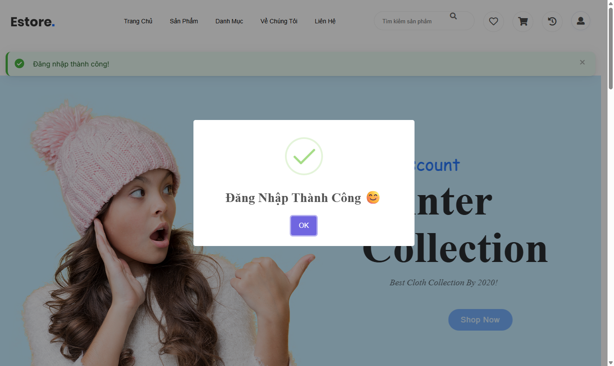
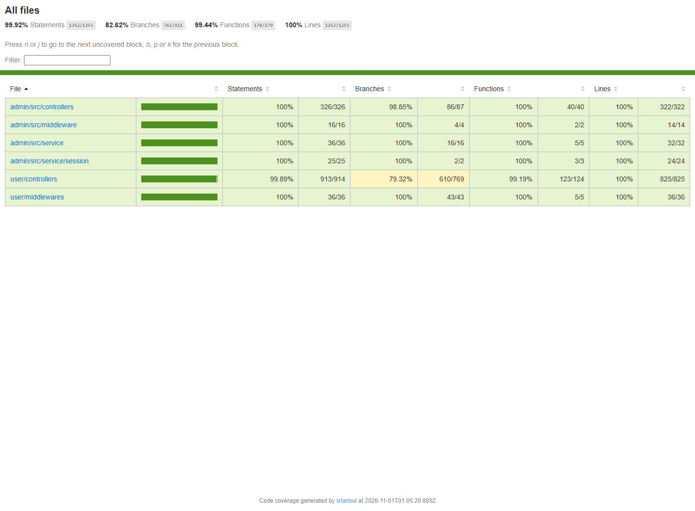
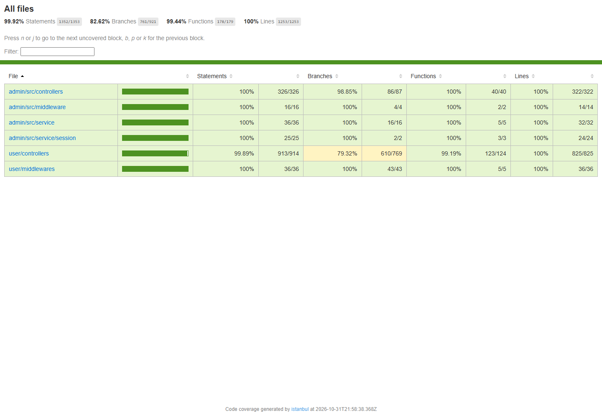
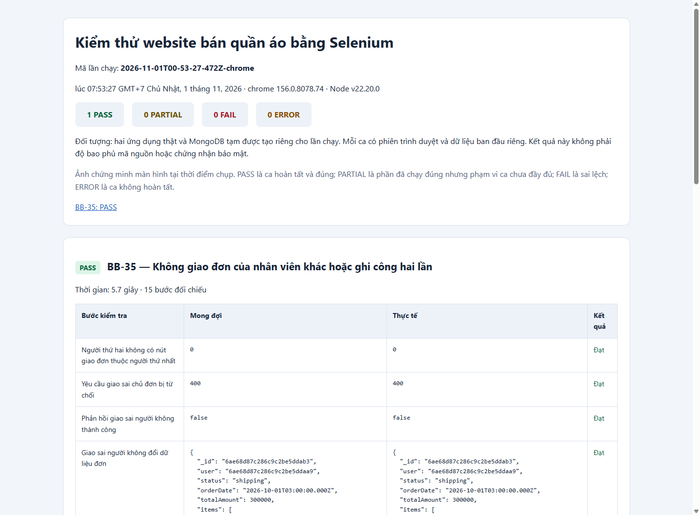
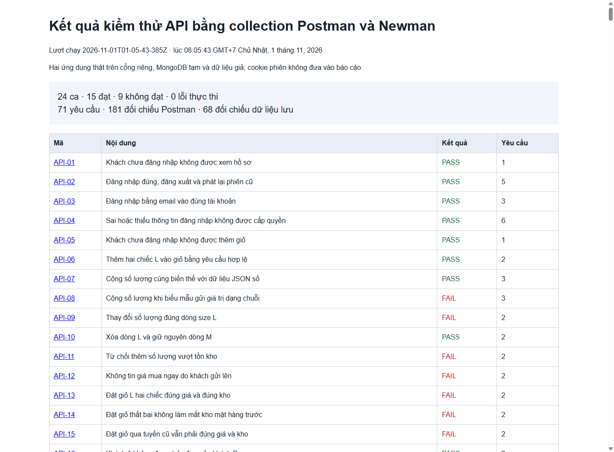
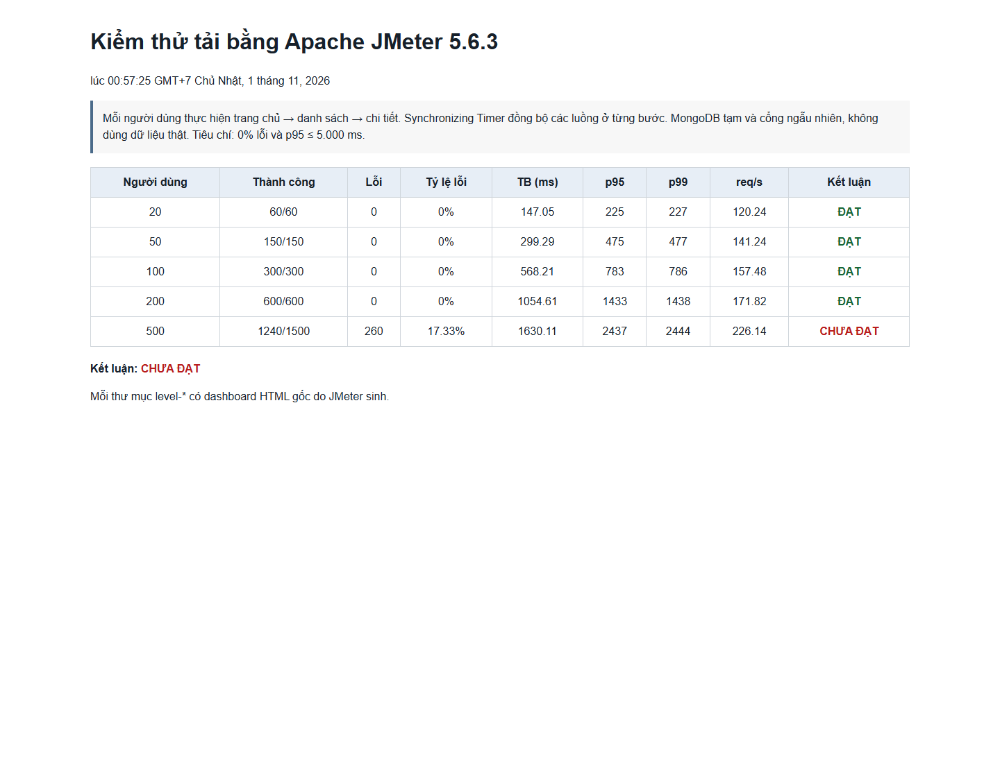
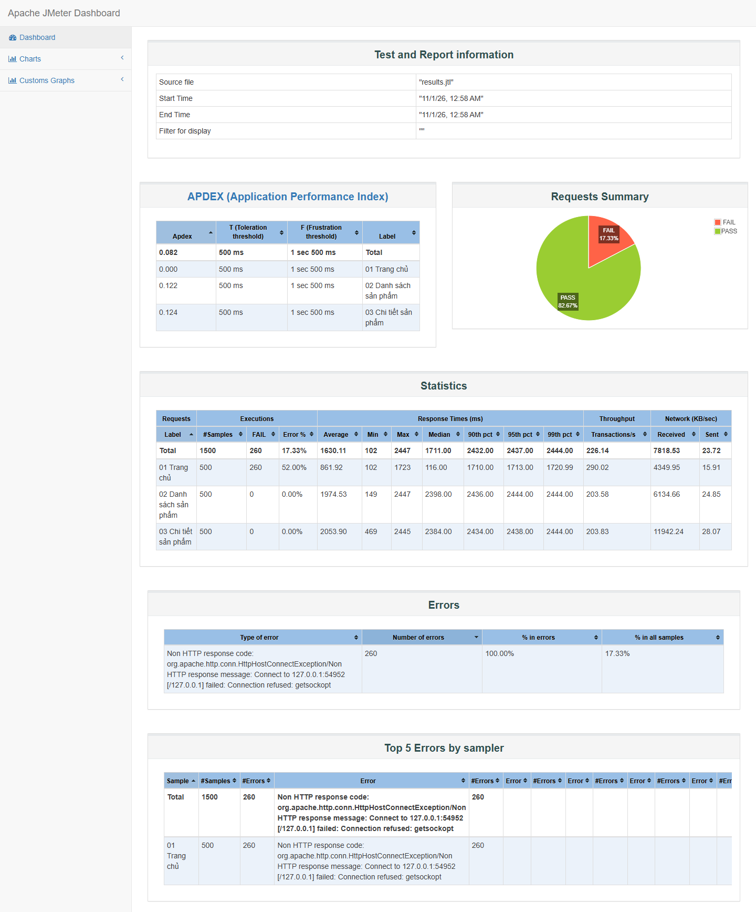

# KIỂM ĐỊNH VÀ ĐẢM BẢO CHẤT LƯỢNG PHẦN MỀM

## Website bán quần áo trực tuyến – Nhóm 10

Repository này lưu kế hoạch kiểm thử và bộ ảnh minh chứng của quá trình đánh giá Website bán quần áo trực tuyến. Hệ thống được xây dựng bằng Node.js, Express, EJS và MongoDB, gồm ba nhóm tác nhân: khách hàng, quản trị viên và nhân viên giao hàng.

## 1. Nội dung repository

```text
Kiem_dinh_nhom10/
├── README.md
├── KE_HOACH_KIEM_THU.md
└── minh-chung/
    ├── MC-BB-*.png          # Kiểm thử hộp đen
    ├── MC-WB-*.png          # Kiểm thử hộp trắng và độ phủ
    ├── MC-UI-*.png          # Kiểm thử giao diện Selenium
    ├── MC-PM-*.png          # Kiểm thử API Postman/Newman
    ├── MC-ADV-*.png         # Kiểm thử nâng cao và bảo mật
    ├── MC-JMETER-*.png      # Kiểm thử tải Apache JMeter
    └── các ảnh đối chiếu hệ thống khác
```

- [Kế hoạch kiểm thử](KE_HOACH_KIEM_THU.md)
- [Thư mục ảnh minh chứng](minh-chung/)

## 2. Phạm vi kiểm thử

Kế hoạch bao phủ các nội dung chính sau:

- Kiểm thử hộp đen bằng phân lớp tương đương, phân tích giá trị biên, bảng quyết định và kiểm thử chuyển trạng thái.
- Kiểm thử hộp trắng bằng Jest, Supertest, phân tích đồ thị dòng điều khiển và đo độ phủ mã nguồn.
- Kiểm thử giao diện bằng Selenium WebDriver trên Chrome và Firefox.
- Kiểm thử API bằng Postman và Newman, có đối chiếu dữ liệu MongoDB.
- Kiểm thử đồng thời, tính lặp an toàn, dữ liệu bất thường, phân quyền và yêu cầu khác nguồn.
- Kiểm thử tải bằng Apache JMeter ở các mức 20, 50, 100, 200 và 500 người dùng đồng thời.

## 3. Quy mô và kết quả tổng hợp

Bộ kiểm thử cấp báo cáo gồm 94 ca. Kết quả được giữ nguyên theo quan sát thực nghiệm; ca Chưa đạt thể hiện phần mềm có sai lệch so với kết quả mong đợi, không phải bộ kiểm thử bị hỏng.

| Nhóm kiểm thử | Quy mô | Đạt | Chưa đạt |
|---|---:|---:|---:|
| Hộp đen | 36 ca | 25 | 11 |
| Hộp trắng | 18 ca | 17 | 1 |
| Selenium | 8 ca | 5 | 3 |
| Postman/Newman | 24 ca | 15 | 9 |
| Nâng cao và bảo mật | 8 ca | 2 | 6 |
| **Tổng cộng** | **94 ca** | **64** | **30** |

Kết quả Jest gồm 134/134 phép kiểm tra đạt. Độ phủ mã nguồn trong phạm vi đo đạt 100% dòng, 99,92% câu lệnh, 99,44% hàm và 82,62% nhánh.

Đối với JMeter, các mức 20, 50, 100 và 200 người dùng đồng thời đạt tiêu chí 0% lỗi và p95 không quá 5.000 ms. Mức 500 người dùng ghi nhận 260/1.500 yêu cầu lỗi, tương đương 17,33%, nên được kết luận Chưa đạt trong môi trường thử nghiệm cục bộ.

## 4. Một số minh chứng tiêu biểu

### 4.1. Giao diện hệ thống



### 4.2. Jest và độ phủ hộp trắng





### 4.3. Selenium trên Chrome và Firefox




### 4.4. Postman và Newman



### 4.5. Apache JMeter





## 5. Quy ước minh chứng

Mỗi ảnh được đặt tên theo nhóm kiểm thử và mã ca để có thể truy vết với kế hoạch và báo cáo:

- `MC-BB-xx`: ca kiểm thử hộp đen.
- `MC-WB-xx`: ca kiểm thử hộp trắng hoặc độ phủ Jest.
- `MC-UI-xx`: ca kiểm thử giao diện Selenium.
- `MC-PM-xx`: ca kiểm thử API Postman/Newman.
- `MC-ADV-xx`: ca kiểm thử nâng cao và bảo mật.
- `MC-JMETER-xx`: kết quả kiểm thử tải.

Ảnh minh chứng chỉ ghi nhận trạng thái tại bước được chụp. Kết luận Đạt hoặc Chưa đạt của một ca được xác định từ toàn bộ bước kiểm tra và dữ liệu đối chiếu, không chỉ từ một ảnh riêng lẻ.

## 6. Lưu ý về phạm vi kết luận

Kết quả tải và tương thích phản ánh cấu hình máy, phiên bản trình duyệt và môi trường cục bộ tại thời điểm thực hiện. Kết quả không được suy rộng thành năng lực của một hệ thống production có cấu hình khác. Các lỗi phát hiện trong quá trình kiểm thử được giữ nguyên để phục vụ đánh giá rủi ro và đề xuất khắc phục.
